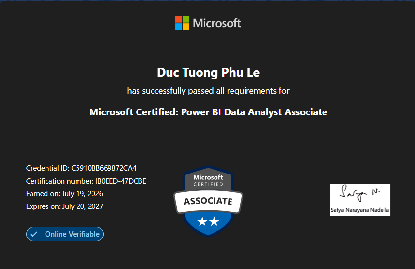
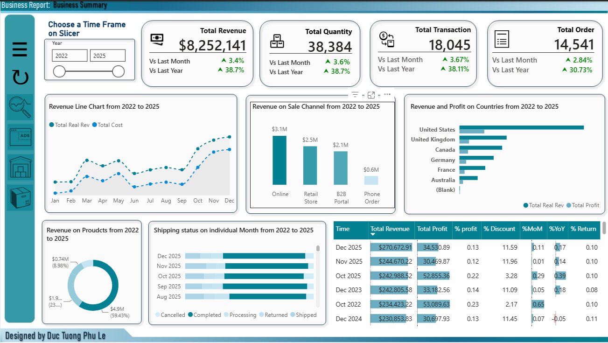
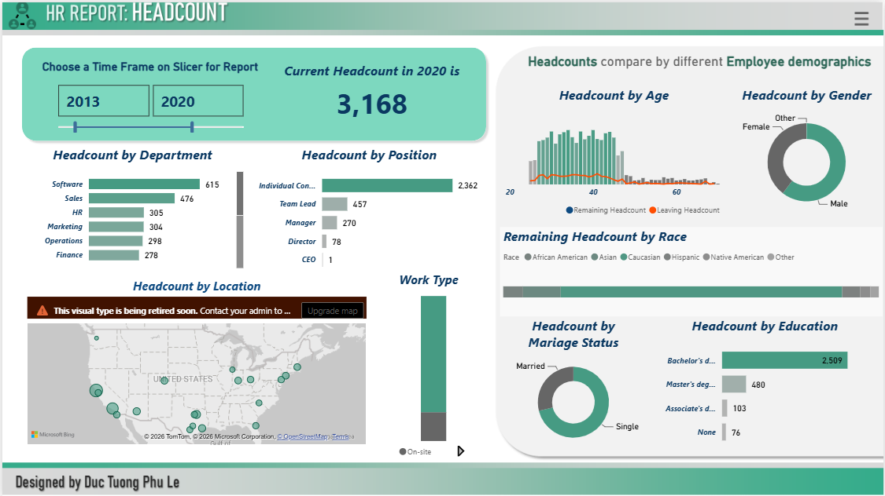

## I'm Duc Tuong Phu Le

  
  
  

## 🚀 About Me 

I am a **Master of Business Intelligence and Analytics** candidate (GPA **81/100**) and **Microsoft Certified: Power BI Data Analyst Associate (PL-300)** focused on turning raw, complex data into clear narratives and practical business decisions.

My hands-on work spans data modeling, querying, and analytics across **SQL**, **Power BI (DAX / Power Query)**, **Python**, **R**, and **Databricks**, covering end-to-end workflows from data preparation and KPI design to interactive reporting and analytical insights.

---

---

<!-- 🌐 Replace "your-username" with your actual GitHub username -->
### 🏆 [Check Out My Full Portfolio Website](https://pforphu.github.io/)
      
## 🔭 What I'm Currently Working On 

<h3>Business Sales Analysis - Power BI</h3>

Built an interactive dashboard to monitor business health, analyze marketing campaign performance,
track inventory levels, and manage product portfolio performance.

<a href="https://github.com/pforphu/Business-Analyst---Power-BI-" target="_blank">
View Project on GitHub →
</a>

<a href="https://app.powerbi.com/groups/me/reports/fd23adc5-41a3-4f66-ade8-4fbf930b9fa4?experience=power-bi" target="_blank">
View Project on PowerBI Service →
</a>

<h3>HR Analysis - Power BI</h3>

Developed HR dashboards to analyze workforce trends, employee retention,
turnover rates, and key people metrics for management decision-making.

<a href="https://github.com/pforphu/HR-Analysis---Power-BI-" target="_blank">
View Project on GitHub →
</a>

<h3>E-Commerce SQL Project</h3>

Used SQL to clean, transform, and analyze e-commerce data, generating insights into customer behavior,
sales performance, and business operations.

<a href="https://github.com/pforphu/E-Commerce-SQL-Project" target="_blank">
View Project on GitHub →
</a>

<h3>South Australia Incident Analysis - Python</h3>

Analyzed South Australia incident data from 2022-2026 using Python to identify trends,
risk patterns, and factors affecting public safety.

<a href="https://github.com/pforphu/SA-Incidents-Analysis-2022-2026---Python" target="_blank">
View Project on GitHub →
</a>

## 🛠️ Technical Skillset

<!-- This section uses Shields.io badges. You can customize them or create your own!-->

#### Data Analysis & Visualization

  <!-- 💡 Go to Shields.io to create your own badges -->
  
  
  

#### Programming & Automation

  
  

#### Business Intelligence & Analytics

  
  
  
  

